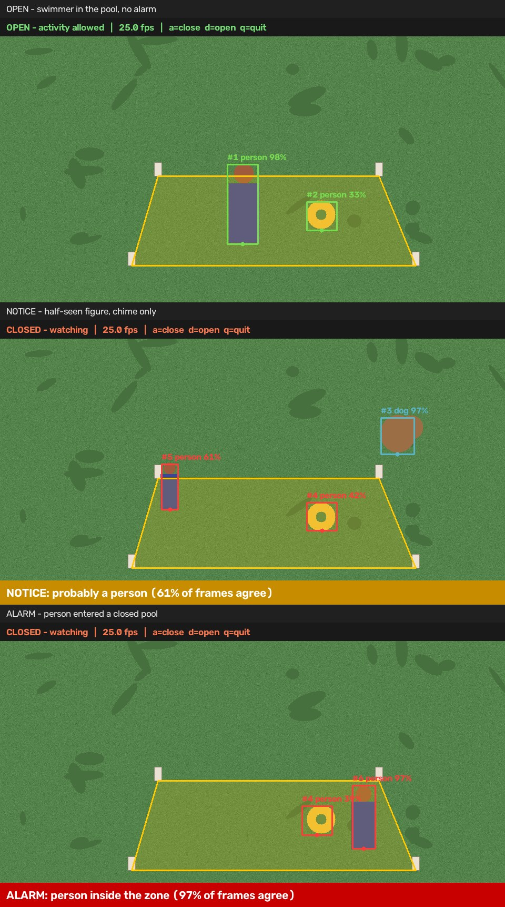
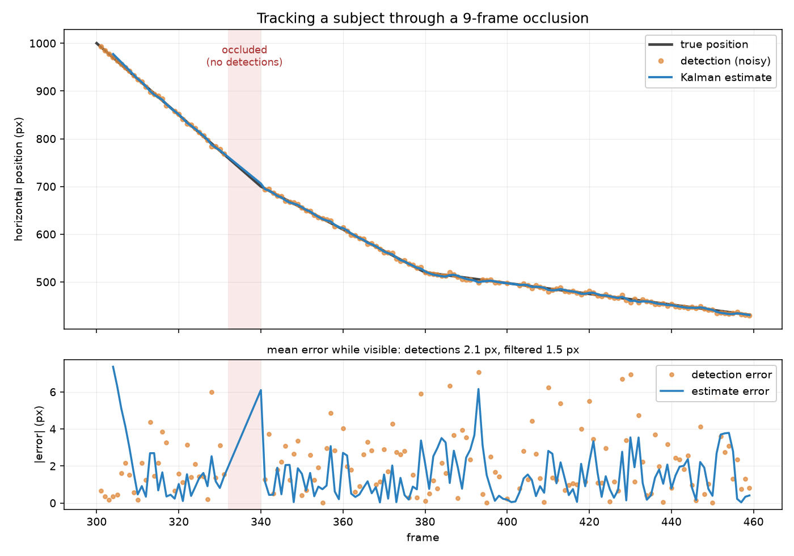

# Pool Guard

A camera that watches a zone and raises the alarm when it should be empty.

Two modes. While the pool is **open**, people swim and nothing happens. Press one
button to **close** it, and anything that walks into the water raises an alarm in
the house — a siren, a snapshot, a line in the log.

The hard part is not detecting people. It is *not* going off for the neighbour's
cat, a shadow moving across the water, or the inflatable ring that has been
floating there since Tuesday. Most of this repository is about that problem.



*Boxes turn red once a subject is inside the zone and the pool is closed — red
means "being evaluated", not "alarming". The float in the third panel is inside
the zone and is deliberately not raising anything.*

## Quick start

```bash
pip install -r requirements.txt
python scripts/download_model.py            # 35 MB detector, one time

# See the whole thing work with no camera and no footage:
python scripts/demo_synthetic.py --out demo.mp4

# The window:
python poolguard_app.py

# Or the console version, with flags:
python -m pool_guard.run --source my_video.mp4
```

The window asks for a video or the webcam, shows you a frame to click the four
corners of the zone on, and then watches. While watching there is one big button
that closes and opens the pool, an exit-delay countdown, playback controls, and
the event log as it happens.

You do not need a pool to try it. Put four objects on the grass to mark the
corners, film it on a phone, click them, and walk in.

The reference frame comes from the video or camera being watched, and only from
there. Marking corners on a separate photograph invites the one mistake that
silently ruins everything downstream: a picture taken from a slightly different
position than the camera now sits in, so the zone is a few degrees off and nobody
can tell by looking.

## Playing at real speed

A 30 fps video analysed frame by frame plays at whatever the detector manages —
about 5 frames a second on a CPU. The result is slow motion. On a live camera it
is worse than slow: undecoded frames pile up in the capture buffer and the delay
grows without limit, so what you are watching drifts further into the past. For a
camera meant to catch someone entering a pool, that defeats the point.

So frames are skipped. Only every 6th is decoded and analysed, the rest are
discarded without being looked at. Five analysed frames a second consume thirty
source frames a second — real time. The picture updates five times a second
rather than thirty, so motion looks a little steppy, but it is *current*, and
every frame on screen is precisely the frame its boxes were computed from.

That last part is why this beats running detection on a background thread.
Threads would give a smooth 30 fps picture, but the boxes would always belong to
a frame from one detection ago, and it would cost locks, a queue, and a class of
bug where a worker thread reaches into a widget. One loop with frames skipped
keeps the video and the detector in step by construction.

`frame_stride` in the settings file controls it. Raise it on a slower machine —
the picture updates less often but stays in real time.

## Settings

`poolguard.ini` is written next to the program on first run, with a comment on
every line:

```ini
[alarm]
dwell_seconds = 0.5      ; uninterrupted time inside the zone before reporting
grace_seconds = 8        ; exit delay after closing, so swimmers can climb out
cooldown_seconds = 20    ; minimum gap between two reports of the same subject
sound = yes

[detector]
confidence = 0.35
width = 960              ; downscale before detection
frame_stride = 6         ; analyse every Nth frame — see above

[classes]
person = alarm
dog = notice             ; a dog can drown too, but a chime is enough
cat = ignore             ; would cry wolf every night

[zone]
point_1 = 0.10417,0.62500   ; written when you mark the corners
point_2 = 0.94618,0.61035   ; fractions of the frame, so any resolution works
point_3 = 0.74653,0.32227
point_4 = 0.20833,0.35156
source = c:\tmp\pool.mp4    ; reopened on the next start
```

**The same pool is never marked twice.** The corners and the source go into the
settings file, so the next start reopens that video with those corners already in
place and the only thing left to do is press Start. Delete the four `point_`
lines to mark a new area. This began life as a separate `zone.json` plus a "use
saved zone" button, which meant re-picking the video every single time — a
pointless ritual for a camera that has not moved.

## How it works

```
frame ─▶ detector ─▶ tracker ─▶ monitor ─▶ alarm
         what is    is it the   should     siren,
         it?        same thing  anyone     snapshot,
                    as before?  be told?   log line
```

**Detector** — YOLOX-S run through `cv2.dnn`. No PyTorch, no GPU: a 35 MB ONNX
file on the CPU. Using a COCO-trained detector is what makes "person or dog or
forgotten inflatable?" answerable at all — COCO has separate `person`, `dog` and
`cat` classes, and no class for pool floats or garden furniture, so an inflatable
is usually not reported. Motion-based detection can only ever say "some pixels
changed", which is hopeless around water and moving shade.

**Tracker** — a Kalman filter per subject plus IoU matching, a compact SORT
variant. `pool_guard/kalman.py` is written from scratch on NumPy. This buys three
things the alarm logic depends on: stable boxes, tracks that survive a detector
dropout, and velocity, which is never measured directly.

**Monitor** — the policy. Armed/disarmed, dwell time, class rules, cooldown,
grace period, scenery whitelist. It does no I/O and takes the current time as an
argument, so its behaviour is fully reproducible in tests.

**Alarm** — sound on a daemon thread (a blocking siren would freeze the video at
the exact moment you most want to keep watching), an annotated snapshot, and one
JSON line per event.

Events are stamped with the position **in the recording** — `4:32` is somewhere
you can scrub to, whereas the wall-clock time the frame happened to be analysed
tells you nothing about where to look. A live camera has no such position, so
there the time of day is the only meaningful stamp.

## Tracking through an occlusion

The subject below is invisible for nine frames, right as they cross the boundary
— the worst possible moment to lose them. The filter coasts the track through the
gap, so the track keeps its identity and the dwell counter keeps running. Without
it the track would break in two, the counter would restart from zero, and the
alarm would be late or absent.



While the subject is visible, filtering also cuts the mean position error from
2.1 px to 1.5 px. That figure is regenerated from the real pipeline by
`scripts/make_figures.py`, not drawn by hand.

## Not crying wolf

No vision system distinguishes a person from a dog from a floating toy with
certainty, and this one does not pretend to. Instead it is built so that when it
is unsure, it says so, and when it is wrong it is wrong in the safe direction.

**Failure costs are asymmetric.** A false alarm is an annoyance; a miss can be a
drowned child. So the detector threshold is deliberately low, and the noise that
lets in is removed by *agreement over time* rather than by demanding more of any
single frame.

**Certainty is graded, not binary.** A weakly supported subject raises a NOTICE —
a soft chime and a saved still, "come and look". Only a well supported one raises
an ALARM. The ambiguous middle goes to a human instead of being guessed at.

Six filters, each aimed at a specific way real footage produces nonsense:

| Filter | What it stops |
| --- | --- |
| Class policy | Cats are ignored; dogs get a chime, not a siren |
| Label voting over the track's life | A yellow float labelled `person` on one frame out of forty |
| Detection rate, occlusion-aware | Shimmer on the water detected in scattered frames |
| Dwell time (0.5 s) | Detections flickering on the zone boundary |
| Scenery whitelist, keyed by position | The inflatable left in the water when you closed the pool |
| Grace period after closing | The swimmer still climbing out when you pressed the button |
| Per-track cooldown | One intrusion becoming two hundred log entries |
| Sightings only, never predictions | A track that lost its subject alarming on nobody |

Four of those deserve their own note, because all four started out wrong.

**Every threshold is in seconds, never in frames.** They were originally counted
in frames, and when the engine began analysing every 6th frame instead of every
frame, each one silently became six times longer. "Survives 12 frames without a
detection" went from 0.4 seconds to 2.4 seconds, so a track that had lost its
subject kept being predicted and drifted across the lawn as a box around nobody.
Nothing crashed and nothing looked broken — the system simply did everything at
the wrong speed. Expressed in seconds, the stride cannot change any behaviour.

**An alarm requires a current sighting, not a prediction.** Coasting a track
through a gap is what preserves identity across an occlusion, but a predicted box
is not evidence that anybody is there. Coasting tracks are therefore neither drawn
nor allowed to raise anything, and their dwell timer is frozen rather than reset so
an occluded person resumes where they left off. Without this a lost track could
accumulate the full dwell time on predicted positions alone and fire on an empty
lawn. On real footage this took visible boxes-around-nobody from 5.6% of analysed
frames to zero.

**Matching needs a second pass on distance.** At five analysed frames a second a
walking person moves more than their own width between frames, so their predicted
box and their next detection do not overlap at all. Overlap-only matching
abandoned them and started a new track every few frames — and every abandoned
track became one of those phantom boxes. An unmatched detection may now still join
an unmatched track if their centres are close relative to the box size.

**Flicker and occlusion are different failure modes.** Both lose frames, but they
mean opposite things: scattered gaps are what an unreliable detection looks like,
while one long gap is a real subject that went behind a chair. Scoring them the
same way meant a person who was briefly hidden came out of it looking *less*
certainly a person — which downgraded a siren to a chime, exactly backwards for a
safety alarm. `Track.detection_rate` counts short gaps against a track and
excludes long ones.

**The scenery whitelist is keyed by position, not by track id.** A flickering
object loses its track and is reborn under a fresh id, which let a static float
walk straight out of an id-based whitelist and set off a false alarm. Its
location, unlike its id, does not change.

## Measuring the zone, and the measurement that was removed

Fill in the `[measurements]` section — the four sides and at least one diagonal,
in centimetres — and speeds are reported in metres per second instead of pixels.
Leave it blank and everything works identically, in pixels.

The zone is a quadrilateral and does not have to be a rectangle; a real garden
rarely is. **One diagonal is required**, and there is a reason: a triangle is
rigid, three sides determine it, but a quadrilateral is not. Given only its four
sides it flexes like a hinged frame, so those four numbers describe infinitely
many shapes. One diagonal cuts it into two rigid triangles.

**Measure both diagonals and the spare one audits the other five.** On the garden
this was built against (309, 452, 340, 457 cm sides) the unused diagonal came out
3.1 cm from the 579 cm measured: 0.5%, which is what careful tape work on grass
looks like. Type one digit wrong and the same check jumps to 90 cm and says so.

**Height is not offered, and that is a decision rather than an omission.** An
earlier version estimated it from the ground-plane homography. Tested against a
real garden camera — mounted high and angled down, as these always are — it
reported a 186 cm adult as anywhere from 154 to 204 cm, changing as he walked
towards the camera, and it called a 160 cm teenager "adult" and a 60 cm dog
"child-sized". A homography describes one flat surface, and a standing person's
head is not on it. Doing it properly needs the vertical vanishing point or full
camera pose. Until then the honest answer is no answer: in a safety system a
confident wrong number is worse than an absent one, because it invites decisions
the measurement cannot support.

## Standalone executable (Windows)

```bash
python build_exe.py            # -> dist/PoolGuard.exe, about 107 MB
```

One self-contained file: no Python, no PyTorch, no GPU, nothing to install on the
machine that runs it. Double-clicking opens the window. Command-line flags still
work and go straight to the console version.

Four things the packaging has to get right:

- **Bundled resources and written data are different directories.** The detector
  weights ride inside the executable and are unpacked to a temporary folder;
  `zone.json`, `poolguard.ini` and `events/` are written next to the executable.
  Writing data to the unpack directory appears to work and then silently vanishes
  on exit, taking every saved alarm snapshot with it.
- **The entry script must sit outside the package.** PyInstaller runs it as
  `__main__` with no parent package, so `pool_guard/main.py` as the entry point
  fails on its first relative import. `poolguard_app.py` exists only to import the
  package absolutely.
- **A windowed build has no console**, so an unhandled exception makes the program
  vanish with no explanation — the worst failure mode for someone who just
  double-clicked it. `main.py` catches anything that escapes, writes
  `poolguard-error.log` next to the executable, and shows it. Given command-line
  arguments it attaches to the calling terminal so printing works normally.
- **`cv2.imread` and `cv2.imwrite` cannot handle non-ASCII paths on Windows.** They
  fail *quietly*, returning None, so a perfectly valid photo looks like a corrupt
  file — which is exactly what happened with a Hebrew filename. `imaging.py` reads
  and writes the bytes in Python and decodes in memory instead.

SciPy is excluded from the build — it is only used for optimal
detection-to-track assignment, `tracker.py` falls back to greedy matching, and
leaving it out saves about 60 MB.

## What it deliberately does not do

- **It does not measure how tall anyone is.** See above.
- **It needs light.** An ordinary camera sees nothing useful in a dark garden; a
  night-time deployment needs an IR camera.
- **It is not a life-safety device.** It is a portfolio project. Real pool safety
  is a fence, a gate lock, and an adult watching. Nothing here replaces those.
- **It processes video locally and uploads nothing.**

## Tests

```bash
pip install -r requirements-dev.txt
python -m pytest tests -q      # 146 tests, a couple of seconds
```

The suite needs no camera, no footage and no model file: `pool_guard/synthetic.py`
provides a scripted scene with ground truth and feeds the tracker the kind of
imperfect input a real detector produces — jittery boxes, missed frames, an
occasional wrong label.

`tests/test_scene.py` pins the end-to-end behaviour on a scene with five subjects
at once: exactly one alarm and one notice, silence while the pool is open, silence
for the float, silence for the dog outside the zone, and the alarm firing on the
person who walks in. A well-meant threshold tweak that reintroduces a false alarm
fails CI instead of being discovered by a siren at midnight.

Several bugs here were caught by writing a test rather than by reading the code: a
track that never confirmed when `min_hits=1`, a Hebrew filename that `cv2.imread`
refused, and — in the figure script rather than the system — ground-truth pairing
by centre distance, which silently plotted a float's track as the intruder and
made the filter look three times worse than the raw detections it was cleaning up.

## Layout

```
pool_guard/
  kalman.py      linear Kalman filter from scratch, and the box-tracking wrapper
  tracker.py     IoU matching, track lifecycle, per-track label voting
  detector.py    YOLOX-S via cv2.dnn: letterbox, anchor-free decode, NMS
  zone.py        polygon zone, ray-casting point-in-polygon
  monitor.py     the decision layer: modes, dwell, scenery, severity
  alarm.py       siren, snapshot, JSONL log, optional Telegram
  engine.py      one analysed frame: skip, detect, track, decide, draw
  setup_gui.py   the window: mark the zone, then watch it
  config.py      poolguard.ini next to the program
  imaging.py     image I/O that survives non-ASCII paths; frames into tkinter
  layout.py      four sides + a diagonal -> a ground plan in centimetres
  calibration.py the pixel-to-centimetre homography, and what it cannot do
  main.py        entry point for the packaged executable
  paths.py       bundled resources vs written data, frozen or from source
  synthetic.py   scripted scene + ground truth, for the demo and the tests
build_exe.py     PyInstaller build
poolguard_app.py launcher for the frozen build (see the packaging notes)
scripts/
  download_model.py   fetch the detector weights
  demo_synthetic.py   run the pipeline over the scripted scene, write a video
  check_detector.py   sanity-check the detector on a still photo
  make_figures.py     regenerate the README figures
```

## Notes

Point-in-polygon is twelve lines of ray casting rather than a Shapely
dependency. It handles concave shapes, which matters because a real pool deck is
rarely a neat rectangle, and a bounding-box test would pass points the polygon
does not contain.

The Kalman covariance update uses the Joseph form. It is algebraically identical
to `(I - KH)P` but stays symmetric and positive-definite over thousands of
updates, where the short form can drift asymmetric and quietly diverge — for a
process that runs for days, that matters.

The filter takes an explicit `dt` per step. Detection does not run once per frame,
so the interval between updates is not the frame interval, and a filter told the
wrong elapsed time expects motion that had no time to happen.

The model is YOLOX-S from the [OpenCV Model Zoo](https://github.com/opencv/opencv_zoo),
Apache-2.0.
